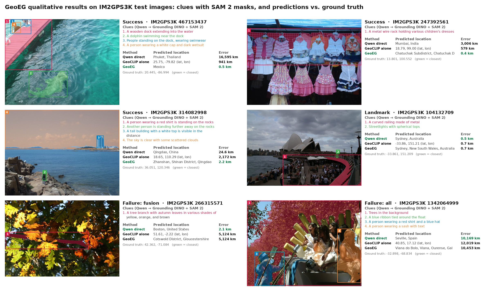
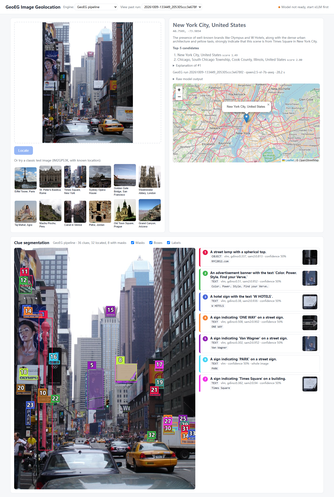

# GeoEG Experiment Report

Oct 13, 2026 · @Jiang Hao

## Summary

GeoEG is an evidence-graph system for image geolocation that runs entirely on a single consumer GPU. It combines a vision-language model (Qwen2.5-VL-7B), visual clue isolation (Grounding DINO + SAM 2 + OCR), deterministic text evidence and image-to-GPS retrieval (GeoCLIP, G3), and decides the final location over an explicit graph of clues and candidates. On 200 held-out IM2GPS3K test images it reaches a **median error of 198 km**, compared with 247 km for direct Qwen prediction and 208 km for GeoCLIP alone, and it has the best accuracy at the 1 / 25 / 200 / 750 km thresholds. Median latency is **15.9 s per image** with a peak of about **14.8 GB VRAM** on an RTX 5070 Ti, and every prediction comes with the clues, masks and evidence that support it.

## System architecture

```mermaid
flowchart LR
    IMG([Input image]) --> P1

    subgraph P1[1 · Parallel perception]
        direction TB
        A[Qwen2.5-VL-7B<br/>direct coordinate prediction<br/><i>anchor</i>]
        B[Qwen2.5-VL-7B<br/>description-only clues]
        C[PaddleOCR<br/>resident worker]
    end

    P1 --> P2[2 · Clue isolation<br/>Grounding DINO boxes<br/>→ SAM 2 masks]
    P2 --> P3[3 · Deterministic evidence<br/>script · calling code · plate prefix<br/>geocoded place names · driving side]

    P1 --> P4
    P3 --> P4[4 · Candidate pool<br/>VLM anchor ∪ place-name hits<br/>∪ GeoCLIP gallery top-20<br/>scored by G3 + GeoCLIP]

    P4 --> P5[5 · Evidence graph<br/>clue & candidate nodes<br/>support / refine / contradict edges]
    P5 --> P6[6 · Decision<br/>place-name check · anchor override<br/>200 km local refinement]
    P6 --> OUT([Top-5 locations<br/>+ cited explanations<br/>+ masks, graph, log])
```

The pipeline has six stages:

1. **Parallel perception.** Two calls to the locally served Qwen2.5-VL-7B (AWQ, vLLM) run alongside OCR. One asks the model for coordinates directly and serves as the anchor; the other only asks what is visible (text, objects, infrastructure, environment, lighting), so that clue descriptions are not mixed with location guesses.
2. **Clue isolation.** Grounding DINO localizes each text, object and infrastructure clue, and SAM 2 segments it into a pixel mask, so each clue is tied to a concrete image region.
3. **Deterministic evidence.** Rules that do not depend on the VLM's guesses turn clues into location constraints: writing system, international calling codes, Chinese plate prefixes (geo-sleuth tables), place names in the image text geocoded with OpenStreetMap Nominatim, and driving side.
4. **Candidate pool.** The VLM anchor, geocoded place names and the GeoCLIP gallery top-20 form the candidates. Each candidate is scored by image-to-location similarity from both G3 and GeoCLIP, and gallery points within 200 km of the main candidates are prefetched for refinement.
5. **Evidence graph.** Clues and candidates become nodes in a NetworkX graph, linked by support, refine and contradict edges, and saved as JSON with every run.
6. **Decision.** A clear, confirmed place name is close to decisive; the VLM anchor is replaced only when retrieval similarity clearly favours another candidate; the result is then refined by local G3 + GeoCLIP reranking within 200 km of the anchor. Decision parameters were tuned by grid search on a separate 100-image development split.

Each run writes a self-contained folder (`result.json`, `graph.json`, `log.jsonl`, clue crops and masks), so every prediction can be traced back to the evidence behind it. A GPU manager loads and releases the detection, segmentation and retrieval models on demand so that the whole system, including the 7B VLM, fits on one 16 GB card with no cloud API.

## Experimental setup

- **Data**: 200 test images from IM2GPS3K (seed 2026), none of them used for any tuning.
- **Baselines**: *Qwen direct*, where Qwen2.5-VL-7B-Instruct (AWQ, vLLM) outputs coordinates directly with the same prompt as GeoEG's anchor; and *GeoCLIP alone*, GeoCLIP image-to-GPS retrieval only.
- **Hardware**: a single NVIDIA RTX 5070 Ti 16 GB, everything run locally.
- **Metrics**: great-circle distance between prediction and ground truth. We report accuracy within 1 / 25 / 200 / 750 / 2500 km (street / city / region / country / continent) and the error distribution.

## Results

### Accuracy at distance thresholds

Share of images whose prediction falls within each distance of the true location; higher is better, and bold marks the best in each column.

| Method | ≤1 km | ≤25 km | ≤200 km | ≤750 km | ≤2500 km |
| --- | --- | --- | --- | --- | --- |
| Qwen direct | 4.5% | 28.0% | 49.0% | **65.0%** | 77.0% |
| GeoCLIP alone | 12.0% | 30.0% | 49.5% | 64.0% | **78.5%** |
| **GeoEG** | **13.0%** | **31.5%** | **50.0%** | **65.0%** | 78.0% |

GeoEG nearly triples street-level accuracy over the VLM alone (4.5% to 13.0%) while matching its country-level accuracy, and it leads at every threshold up to 750 km.

### Error distribution

Error in km; lower is better.

| Method | Mean | Median | 25th pct | 75th pct | 90th pct |
| --- | --- | --- | --- | --- | --- |
| Qwen direct | 2115 | 247 | 16 | 2085 | 8613 |
| GeoCLIP alone | 1996 | 208 | 7 | 2086 | **7068** |
| **GeoEG** | **1950** | **198** | **6** | **1764** | 7473 |

GeoEG has the lowest mean, median, 25th and 75th percentile errors. The median drops by 49 km (20%) relative to direct VLM prediction, and the 75th percentile improves by more than 300 km relative to both baselines.

### Per-image comparison

Which method's prediction is closer to the true location on the same image.

| Comparison | Baseline closer | GeoEG closer | Tie |
| --- | --- | --- | --- |
| Qwen direct vs GeoEG | 96 | 103 | 1 |
| GeoCLIP alone vs GeoEG | 47 | 63 | 90 |

Where GeoEG and GeoCLIP disagree, GeoEG is closer on 63 of 110 images.

### Qualitative examples

Six test images: three where GeoEG beats both baselines, one landmark all methods get right, and two hard cases. Each panel shows the clues Qwen proposed, localized by Grounding DINO and segmented by SAM 2 (numbered masks), and each method's prediction with its error; green marks the closest.

The three success cases show what the evidence graph adds. On the dolphin dock (467153437) the VLM guessed Phuket, 16,595 km away, and GeoCLIP missed by 941 km, yet GeoEG landed 0.5 km from the true spot in Mexico. On the market stall (247392561) GeoEG located Chatuchak in Bangkok to within 0.4 km where the baselines were off by 3,006 km and 579 km. On the Qingdao coast (314082998) it kept the VLM's correct city and refined it from 24.6 km to 2.2 km while GeoCLIP was 2,172 km off. The two hard cases carry little location signal in the image (autumn leaves, a festival float).

### Efficiency

| Metric | Value |
| --- | --- |
| Median latency per image | 15.9 s (down from 26.8 s for our first pipeline design) |
| Peak GPU memory | ~14.8 GB |
| Hardware | 1× RTX 5070 Ti 16 GB, fully local |

The latency gain comes from running the VLM calls and OCR in parallel, keeping OCR in a resident worker, and caching external lookups.

## Interactive demo

GeoEG is also served as a local web page (FastAPI backend, `web/`). A user uploads a photo or picks one of the bundled IM2GPS3K examples and gets the predicted place on a map, the Top-5 candidates with scores, a written explanation, and an interactive clue-segmentation view with masks, boxes, OCR text and per-clue sources. Past runs can be reopened from the history menu.

The screenshot shows a saved run on a Times Square photo: GeoEG reads the "Times Square", "W HOTELS" and "OLYMPUS" signs among 36 clues, segments them, and places the image in New York City (28.2 s for this run, which included the full segmentation display).

## Conclusions

- **Fusing a VLM with retrieval through an evidence graph beats either alone.** GeoEG gives the lowest median (198 km), mean and interquartile errors of the three methods and the best accuracy from street to country level.
- **Fine localization comes from combining signals.** The 7B VLM often names the right region but rarely the street; GeoCLIP and G3 retrieval plus local refinement around the VLM anchor turn region-level guesses into sub-kilometre predictions, as in the Mexico, Bangkok and Qingdao examples.
- **Every answer is explainable.** Each prediction is tied to segmented image regions, OCR text, geocoded place names and an explicit graph of supporting and contradicting evidence.
- **It is practical on consumer hardware.** The full system runs locally on one 16 GB GPU at about 16 s per image, with no cloud dependency.
